本文档介绍 Web 应用中常见的认证方案，包括 Session-Cookie、JWT 和 SSO 单点登录，帮助开发者理解各方案的原理、差异及适用场景。

## 认证方案概述 ##

Web 认证的核心问题是：*HTTP 是无状态协议，服务端如何识别用户身份？*

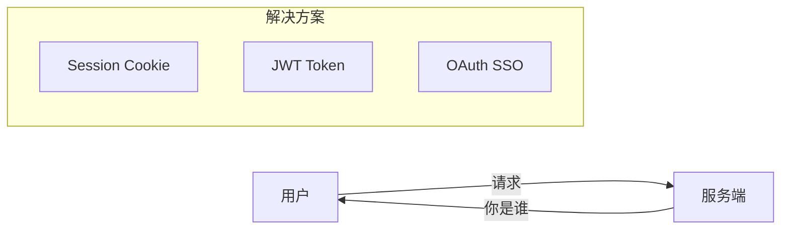

### 认证 vs 授权 ###

| 概念 | 英文 | 解决的问题 | 类比 |
| :--- | :--- | :--- | :--- |
| 认证 | Authentication | 你是谁？ | 身份证 |
| 授权 | Authorization | 你能做什么？ | 门禁卡 |

## Session-Cookie 方案 ##

### 工作原理 ###

Session-Cookie 是传统的有状态认证方案，用户登录信息存储在*服务端*。

```mermaid
sequenceDiagram
    participant U as 用户
    participant C as 客户端
    participant S as 服务端
    participant R as Redis/内存

    U->>C: 输入账号密码
    C->>S: POST /login
    S->>S: 验证凭据
    S->>R: 创建 Session&#x3C;br/>存储用户信息
    R-->>S: sessionId
    S-->>C: Set-Cookie: sessionId=abc123

    Note over C: Cookie 自动存储

    U->>C: 请求数据
    C->>S: GET /api/data&#x3C;br/>Cookie: sessionId=abc123
    S->>R: 查询 Session
    R-->>S: 用户信息
    S-->>C: 返回数据
```

### 代码示例 ###

```ts
// 服务端 - Express + express-session
import session from 'express-session';
import RedisStore from 'connect-redis';

app.use(session({
  store: new RedisStore({ client: redisClient }),
  secret: 'your-secret-key',
  resave: false,
  saveUninitialized: false,
  cookie: {
    secure: true,      // 仅 HTTPS
    httpOnly: true,    // 防止 XSS 读取
    maxAge: 24 * 60 * 60 * 1000  // 24 小时
  }
}));

// 登录
app.post('/login', async (req, res) => {
  const { username, password } = req.body;
  const user = await validateUser(username, password);

  if (user) {
    req.session.userId = user.id;
    req.session.role = user.role;
    res.json({ success: true });
  }
});

// 验证中间件
const authMiddleware = (req, res, next) => {
  if (req.session.userId) {
    next();
  } else {
    res.status(401).json({ error: 'Unauthorized' });
  }
};
```

### 优缺点 ###

| 优点 | 缺点 |
| :--- | :--- |
| 服务端完全控制，可随时踢人 | 需要 Session 存储（Redis/内存） |
| Session ID 较小 | 分布式需要共享 Session |
| 安全性较高（HttpOnly） | 有 CSRF 攻击风险 |
| 实现简单成熟 | 跨域处理复杂 |
| - | 移动端 Cookie 支持有限 |

## JWT 方案 ##

### 什么是 JWT ###

JWT（JSON Web Token）是一种无状态的认证方案，用户信息编码在 Token 中，存储在*客户端*。

JWT 结构：`Header.Payload.Signature`

```txt
eyJhbGciOiJIUzI1NiIsInR5cCI6IkpXVCJ9.    <- Header (Base64)
eyJ1c2VySWQiOjEyMywiZXhwIjoxNjk5OTk5fQ.  <- Payload (Base64)
SflKxwRJSMeKKF2QT4fwpMeJf36POk6yJV_adQssw <- Signature
```

```mermaid
flowchart LR
    subgraph Header
        A[alg HS256&#x3C;br/>typ JWT]
    end

    subgraph Payload
        B[userId 123&#x3C;br/>exp 1699999]
    end

    subgraph Signature
        C[HMACSHA256]
    end

    A --> D[Base64]
    B --> D
    C --> D
    D --> E[JWT Token]
```

### 工作原理 ###

```mermaid
sequenceDiagram
    participant U as 用户
    participant C as 客户端
    participant S as 服务端

    U->>C: 输入账号密码
    C->>S: POST /login
    S->>S: 验证凭据
    S->>S: 生成 JWT&#x3C;br/>(包含用户信息 + 签名)
    S-->>C: 返回 token

    Note over C: 存储到 localStorage

    U->>C: 请求数据
    C->>C: 从 localStorage 读取 token
    C->>S: GET /api/data&#x3C;br/>Authorization: Bearer xxx
    S->>S: 验证签名&#x3C;br/>解析用户信息&#x3C;br/>(无需查库)
    S-->>C: 返回数据
```

### Token 传递方式 ###

| 方式 | 安全性 | 适用场景 |
| :--- | :--- | :--- |
| Authorization Header | 高 | 推荐方案，API 请求 |
| HttpOnly Cookie | 高 | 同域 Web 应用 |
| URL Query Parameter | 低 | 仅用于下载链接、邮件验证等特殊场景 |

```ts
// 方式一：Authorization Header（推荐）
axios.get('/api/data', {
  headers: {
    'Authorization': `Bearer ${token}`
  }
});

// 方式二：通过拦截器自动添加
axios.interceptors.request.use((config) => {
  const token = localStorage.getItem('token');
  if (token) {
    config.headers['Authorization'] = `Bearer ${token}`;
  }
  return config;
});
```

### Token 刷新机制 ###

由于 JWT 无法主动失效，通常采用双 Token 机制：

```mermaid
sequenceDiagram
    participant C as 客户端
    participant S as 服务端

    Note over C,S: 登录时获取双 Token
    C->>S: POST /login
    S-->>C: accessToken (15分钟)&#x3C;br/>refreshToken (7天)

    Note over C,S: Access Token 过期
    C->>S: GET /api/data (accessToken 过期)
    S-->>C: 401 Unauthorized

    Note over C,S: 使用 Refresh Token 刷新
    C->>S: POST /refresh (refreshToken)
    S->>S: 验证 refreshToken
    S-->>C: 新的 accessToken

    C->>S: GET /api/data (新 accessToken)
    S-->>C: 返回数据
```

```ts
// 双 Token 刷新实现
interface TokenPair {
  accessToken: string;   // 短期，15分钟
  refreshToken: string;  // 长期，7天
}

// 响应拦截器 - 自动刷新
axios.interceptors.response.use(
  response => response,
  async error => {
    if (error.response?.status === 401) {
      const refreshToken = localStorage.getItem('refreshToken');

      try {
        const { data } = await axios.post('/auth/refresh', { refreshToken });
        localStorage.setItem('accessToken', data.accessToken);

        // 重试原请求
        error.config.headers['Authorization'] = `Bearer ${data.accessToken}`;
        return axios(error.config);
      } catch {
        // Refresh Token 也过期，跳转登录
        window.location.href = '/login';
      }
    }
    return Promise.reject(error);
  }
);
```

### 优缺点 ###

| 优点 | 缺点 |
| :--- | :--- |
| 无状态，天然支持分布式 | 无法主动失效（需黑名单） |
| 自包含用户信息，减少查库 | Token 较大（200+ 字节） |
| 跨域友好 | 续期机制较复杂 |
| 跨平台（Web/App/小程序） | 敏感信息不能放 Payload |
| 微服务架构友好 | XSS 可窃取（存 localStorage） |

## Session vs JWT 对比 ##

### 架构对比 ###

```mermaid
flowchart TB
    subgraph Session方案
        A1[客户端] -->|Session ID| B1[服务端]
        B1 -->|查询| C1[(Session 存储&#x3C;br/>Redis/内存)]
    end

    subgraph JWT方案
        A2[客户端] -->|JWT Token&#x3C;br/>含用户信息| B2[服务端]
        B2 -->|仅验证签名| B2
    end
```

### 详细对比 ###

| 特性 | Session-Cookie | JWT |
| :--- | :--- | :--- |
| 状态存储 | 服务端（Redis/内存） | 客户端（Token 自包含） |
| 扩展性 | 需要共享 Session 存储 | 天然支持分布式 |
| 服务端压力 | 每次请求查询 Session | 仅验证签名，无 IO |
| 注销/踢人 | 删除 Session 即可 | 较难（需黑名单机制） |
| 安全风险 | CSRF 攻击 | XSS 攻击 |
| 跨域支持 | 需配置 Cookie | 天然支持 |
| 移动端 | Cookie 处理麻烦 | 友好 |
| Token 大小 | ~6 字节（Session ID） | ~200+ 字节 |
| 实现复杂度 | 简单 | 中等（需处理刷新） |

### 分布式场景对比 ##

```mermaid
graph TB
    subgraph Session分布式问题
        U1[用户] --> LB1[负载均衡]

        LB1 --> S1[服务器 A&#x3C;br/>存在 Session]
        LB1 --> S2[服务器 B&#x3C;br/>无 Session]

        S1 -.-> R1[(共享 Redis)]
        S2 -.-> R1
    end
```

```mermaid
graph TB
    subgraph JWT无此问题
        U2[用户&#x3C;br/>携带 Token] --> LB2[负载均衡]

        LB2 --> S3[服务器 A]
        LB2 --> S4[服务器 B]

        S3 --> V1[本地验证 Token]
        S4 --> V2[本地验证 Token]

        V1 --> N1[无需共享存储]
        V2 --> N1
    end
```

## SSO 单点登录 ##

### 什么是 SSO ###

SSO（Single Sign-On）单点登录：*一次登录，多处访问*。

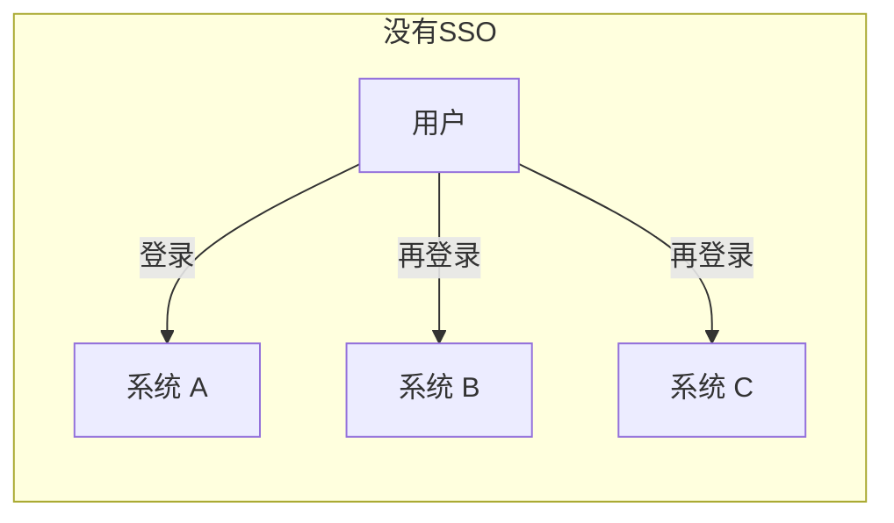

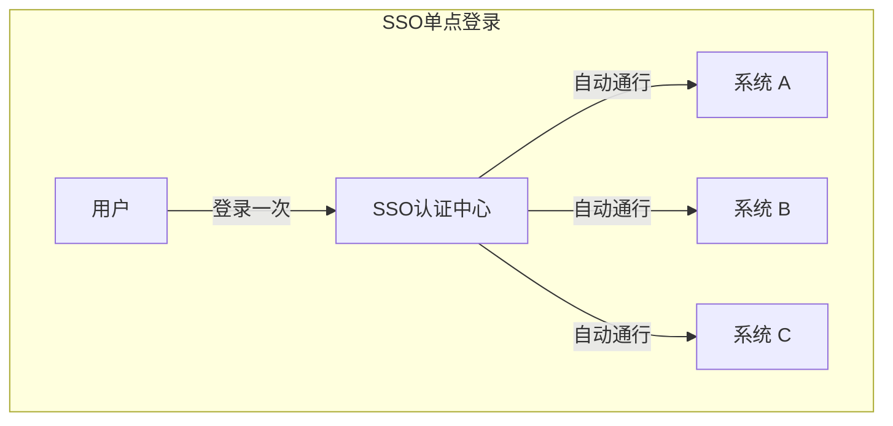

### 常见场景 ###

| 场景 | 说明 |
| :--- | :--- |
| Google 系 | 登录 Gmail 后，YouTube、Drive 自动登录 |
| 阿里系 | 登录淘宝后，天猫、支付宝自动登录 |
| 企业内网 | 登录 OA 后，邮箱、CRM、ERP 都能访问 |
| 微信生态 | 微信登录后，各小程序共享登录态 |

### SSO 实现方案 ###

#### 方案一：共享 Cookie（同域） ####

适用于同一主域下的子系统。

```mermaid
flowchart TB
    subgraph example.com子域
        SSO[sso.example.com&#x3C;br/>认证中心]
        A[a.example.com&#x3C;br/>系统 A]
        B[b.example.com&#x3C;br/>系统 B]
        C[c.example.com&#x3C;br/>系统 C]
    end

    Cookie[Cookie 设置为 .example.com&#x3C;br/>所有子域共享]

    SSO --> Cookie
    A --> Cookie
    B --> Cookie
    C --> Cookie
```

```ts
// 设置共享 Cookie
res.cookie('token', jwtToken, {
  domain: '.example.com',  // 主域名，所有子域共享
  httpOnly: true,
  secure: true
});
```

#### 方案二：CAS 协议（跨域） ####

适用于不同域名的系统。

```mermaid
sequenceDiagram
    participant U as 用户
    participant A as 系统 A&#x3C;br/>(app-a.com)
    participant SSO as SSO 中心&#x3C;br/>(sso.com)

    Note over U,SSO: 首次访问系统 A
    U->>A: 1. 访问系统 A
    A->>A: 2. 检测未登录
    A-->>U: 3. 重定向到 SSO
    U->>SSO: 4. 跳转 SSO 登录页
    U->>SSO: 5. 输入账号密码
    SSO->>SSO: 6. 验证成功&#x3C;br/>创建全局 Session
    SSO-->>U: 7. 重定向回系统 A&#x3C;br/>携带 ticket
    U->>A: 8. 带 ticket 访问
    A->>SSO: 9. 验证 ticket
    SSO-->>A: 10. 返回用户信息
    A->>A: 11. 创建局部 Session
    A-->>U: 12. 登录成功
```

```mermaid
sequenceDiagram
    participant U as 用户
    participant B as 系统 B&#x3C;br/>(app-b.com)
    participant SSO as SSO 中心&#x3C;br/>(sso.com)

    Note over U,SSO: 访问系统 B（已在 SSO 登录）
    U->>B: 1. 访问系统 B
    B->>B: 2. 检测未登录
    B-->>U: 3. 重定向到 SSO
    U->>SSO: 4. 跳转 SSO
    SSO->>SSO: 5. 检测已有全局 Session
    SSO-->>U: 6. 直接返回 ticket&#x3C;br/>（无需再登录）
    U->>B: 7. 带 ticket 访问
    B->>SSO: 8. 验证 ticket
    SSO-->>B: 9. 返回用户信息
    B-->>U: 10. 自动登录成功
```

#### 方案三：OAuth 2.0 / OIDC ####

现代标准，适用于第三方登录和开放平台。

```mermaid
sequenceDiagram
    participant U as 用户
    participant App as 第三方应用
    participant Auth as 授权服务器&#x3C;br/>(如 GitHub)
    participant API as 资源服务器

    U->>App: 1. 点击&#x26;#34;GitHub 登录&#x26;#34;
    App-->>U: 2. 重定向到 GitHub
    U->>Auth: 3. 跳转 GitHub 授权页
    U->>Auth: 4. 用户授权
    Auth-->>U: 5. 重定向回 App&#x3C;br/>携带 code
    U->>App: 6. 带 code 访问
    App->>Auth: 7. 用 code 换 token
    Auth-->>App: 8. 返回 access_token
    App->>API: 9. 用 token 获取用户信息
    API-->>App: 10. 返回用户数据
    App-->>U: 11. 登录成功
```

### SSO 协议对比 ###

| 协议 | 特点 | 适用场景 |
| :--- | :--- | :--- |
| 共享 Cookie | 简单直接 | 同域系统 |
| CAS | 经典企业方案 | 企业内部系统 |
| OAuth 2.0 | 授权协议 | 第三方登录、开放 API |
| OIDC | OAuth 2.0 + 身份层 | 现代标准方案 |
| SAML | XML 格式，企业级 | 传统企业、政府 |

### SSO 与 JWT/Session 的关系 ###

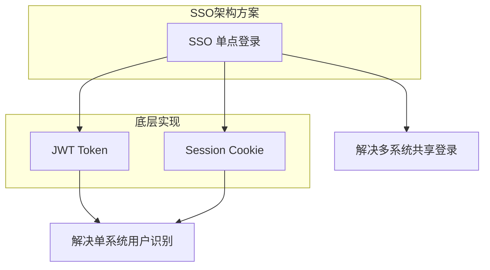


## 方案选型指南 ##

### 决策流程图 ###

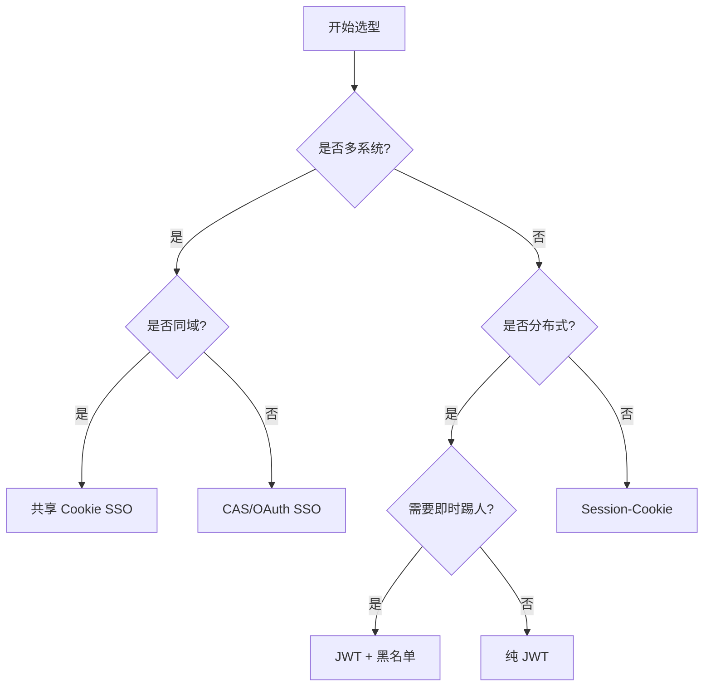

### 场景推荐 ###

| 场景 | 推荐方案 | 理由 |
| :--- | :--- | :--- |
| 单体应用 | Session-Cookie | 简单可靠，支持即时踢人 |
| 微服务架构 | JWT | 无状态，服务独立验证 |
| 移动端 App | JWT | 无 Cookie 限制 |
| 企业内部多系统 | SSO (CAS) | 统一认证管理 |
| 接入第三方登录 | OAuth 2.0 / OIDC | 行业标准 |
| 开放 API 平台 | OAuth 2.0 + JWT | 授权灵活，Token 自包含 |
| 高安全要求 | Session + 短期 Token | 可控性强 |

### 安全建议 ###

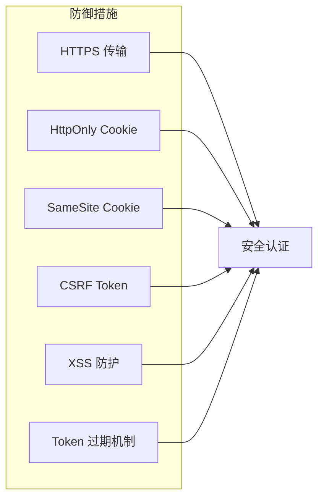

| 攻击类型 | Session 方案 | JWT 方案 |
| :--- | :--- | :--- |
| XSS | HttpOnly 防护 | 避免存 localStorage，或用 HttpOnly Cookie |
| CSRF | 需要 CSRF Token | 使用 Header 传 Token 天然防护 |
| 重放攻击 | Session 过期机制 | Token 过期 + Refresh Token |
| 中间人 | HTTPS | HTTPS |
