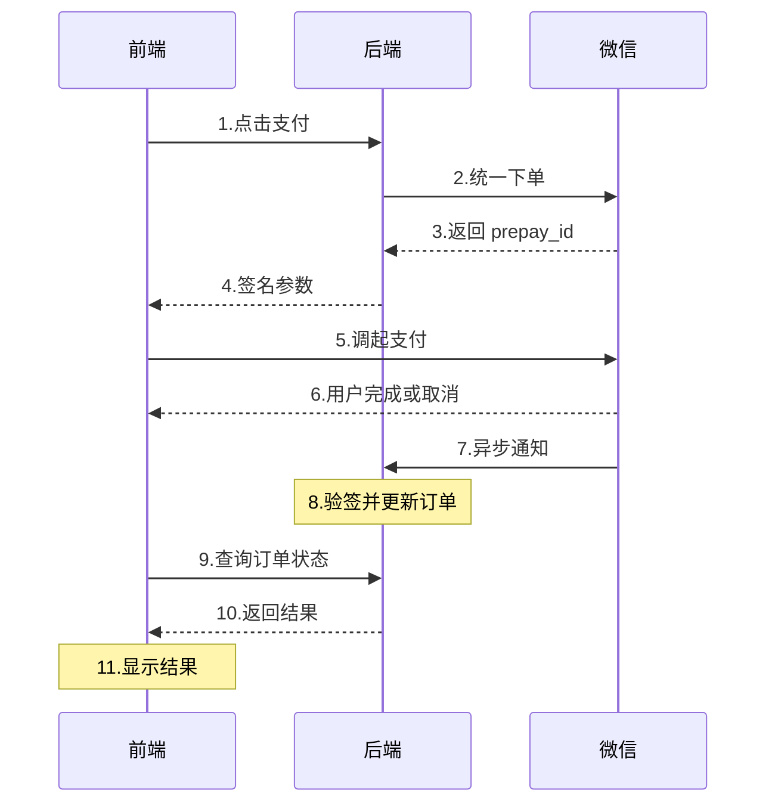
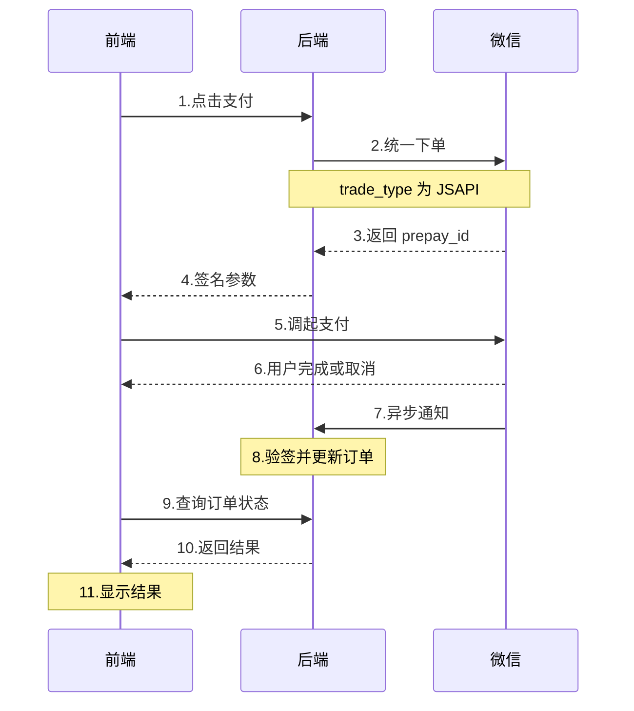

## JSAPI支付（微信内H5） ##

JSAPI支付有两种调用方式：

| 方式 | 特点 | 适用场景 |
| :--- | :--- | :--- |
| **方式A: JSSDK** | 需引入wxjssdk，需wx.config配置签名 | 需要更多微信能力（分享、扫码等） |
| **方式B: WeixinJSBridge** | 无需引入SDK，直接调用微信内置桥 | 只需要支付，代码更简单 |

### 方式A：JSSDK（wx.chooseWXPay） ###

```ts
// 1. 引入JSSDK
// <script src="https://res.wx.qq.com/open/js/jweixin-1.6.0.js"></script>

// 2. 后端提供签名（appId、timestamp、nonceStr、signature）
wx.config({
  appId: 'xxx',
  timestamp: '时间戳',
  nonceStr: '随机串',
  signature: '后端签名',
  jsApiList: ['chooseWXPay']
});

// 3. 发起支付
wx.ready(() => {
  wx.chooseWXPay({
    timestamp: '时间戳',
    nonceStr: '随机串',
    package: 'prepay_id=xxx',
    signType: 'RSA',
    paySign: '签名',
    success: () => checkOrderStatus(orderId),
    fail: () => showCancelResult()
  });
});
```

### 方式B：WeixinJSBridge（推荐简单场景） ###

```ts
// 后端返回支付参数后，直接调用
function onBridgeReady() {
  WeixinJSBridge.invoke('getBrandWCPayRequest', {
    appId: 'xxx',           // 后端返回
    timeStamp: '时间戳',    // 后端返回
    nonceStr: '随机串',     // 后端返回
    package: 'prepay_id=xxx', // 后端返回
    signType: 'RSA',        // 后端返回
    paySign: '签名'         // 后端返回
  }, function(res) {
    if (res.err_msg === 'get_brand_wcpay_request:ok') {
      // 支付成功，但需查询后端确认
      checkOrderStatus(orderId);
    } else if (res.err_msg === 'get_brand_wcpay_request:cancel') {
      // 用户取消
      showCancelResult();
    } else {
      // 支付失败
      showFailResult();
    }
  });
}

// 判断是否在微信环境
if (typeof WeixinJSBridge === 'undefined') {
  document.addEventListener('WeixinJSBridgeReady', onBridgeReady, false);
} else {
  onBridgeReady();
}
```

### JSAPI完整流程（两种方式通用） ###



## 小程序支付 ##

完整流程：




**前端代码**：

```ts
// 1. 调用后端接口获取支付参数
async function handlePay(orderId) {
  const res = await api.createPay(orderId);

  // 2. 调用微信支付
  wx.requestPayment({
    timeStamp: res.timeStamp,     // 后端返回
    nonceStr: res.nonceStr,       // 后端返回
    package: res.package,         // 后端返回，格式：prepay_id=xxx
    signType: res.signType,       // 后端返回，固定RSA
    paySign: res.paySign,         // 后端返回
    success: () => {
      // 支付完成，查询后端确认结果
      checkOrderStatus(orderId);
    },
    fail: (err) => {
      if (err.errMsg === 'requestPayment:fail cancel') {
        // 用户取消
        showCancelResult();
      } else {
        // 支付失败
        showFailResult();
      }
    }
  });
}

// 3. 轮询查询订单状态
function checkOrderStatus(orderId) {
  let count = 0;
  const timer = setInterval(async () => {
    const res = await api.getOrderStatus(orderId);
    if (res.status === 'PAID') {
      clearInterval(timer);
      showSuccessPage();
    }
    if (++count >= 10) {
      clearInterval(timer);
      showPendingPage(); // 处理中
    }
  }, 2000);
}
```

**小程序支付与JSAPI的区别**：

| 对比项 | 小程序支付 | JSAPI支付 |
| :--- | :--- | :--- |
| 运行环境 | 微信小程序内 | 微信内H5页面 |
| 调用API | `wx.requestPayment` | `wx.chooseWXPay` 或 `WeixinJSBridge` |
| 是否需要SDK | 不需要（小程序内置） | JSSDK方式需要，WeixinJSBridge不需要 |
| 签名方式 | RSA | RSA |
| 返回结果 | success/fail回调 | `res.err_msg` 判断 |

## H5支付（微信和支付宝）（普通浏览器） ##

### H5 支付宝支付（普通浏览器） ###

**流程**：

```ts
// 1. 用户点击支付按钮，调用后端创建支付订单
async function handlePay() {
  const res = await api.createAlipayH5({ orderId });

  // 2. 后端返回一段 HTML 表单字符串（包含支付宝网关地址、商户信息、签名等）
  const formHtml = res.form;
  // 例如: <form action="https://openapi.alipay.com/gateway.do" method="post">
  //         <input name="sign" value="xxx"/>
  //         <input name="out_trade_no" value="xxx"/>
  //         ...
  //       </form>

  // 3. 将表单插入页面并自动提交，浏览器跳转到支付宝收银台
  document.querySelector('#pay-container').innerHTML = formHtml;
  document.forms[0].submit();
}
// 4. 用户在支付宝完成支付后，支付宝将浏览器重定向回商户的回调地址（return_url）
//    URL 上会携带 outTradeNo（支付宝交易号）等参数
//    例如: https://yoursite.com/pay-result?outTradeNo=2024xxx&orderId=123

// 5. 回调页面加载后，查询支付结果
window.onload = async () => {
  const outTradeNo = getUrlParam('outTradeNo');
  const orderId = getUrlParam('orderId');

  if (outTradeNo) {
    const result = await api.queryPayResult({ orderId, outTradeNo });

    if (result.payStatus === 'success') {
      // 支付成功 → 跳转成功页
      location.href = '/pay-success?orderId=' + orderId;
    } else {
      // 状态不确定 → 提示用户手动确认
      showConfirmDialog();
    }
  }
};
```

**核心原理**：后端生成一段支付宝标准表单 → 前端自动提交跳转到支付宝 → 支付宝处理完重定向回来 → 前端查询结果

### H5 微信支付（普通浏览器） ###

**流程**：

```ts
// 1. 用户点击支付按钮，调用后端创建支付订单
async function handlePay() {
  const res = await api.createWxH5Pay({ orderId });

  // 2. 后端返回微信支付中间页 URL（mweb_url）
  //    例如: https://wx.tenpay.com/cgi-bin/mmpayweb-bin/checkmweb?prepay_id=xxx
  const mwebUrl = res.mweb_url;

  // 3. 保存订单信息（支付返回时需要查询）
  localStorage.setItem('pendingOrderId', orderId);

  // 4. 跳转到微信支付中间页
  //    微信会自动唤起支付页面，引导用户完成付款
  window.location.href = mwebUrl;
}
// 5. 用户在微信完成支付后，微信将浏览器重定向回商户的 redirect_url
//    URL 上会携带 outTradeNo（微信支付订单号）等参数
//    例如: https://yoursite.com/pay-result?outTradeNo=420000xxx

// 6. 回调页面加载后，查询支付结果
window.onload = async () => {
  const orderId = localStorage.getItem('pendingOrderId');
  const outTradeNo = getUrlParam('outTradeNo');

  if (orderId && outTradeNo) {
    localStorage.removeItem('pendingOrderId');

    const result = await api.queryPayResult({ orderId, outTradeNo });

    if (result.payStatus === 'success') {
      // 支付成功 → 跳转成功页
      location.href = '/pay-success?orderId=' + orderId;
    } else {
      // 状态不确定 → 提示用户手动确认
      showConfirmDialog();
    }
  }
};
```

**核心原理**：后端生成微信支付中间页 URL → 前端直接跳转 → 微信处理完重定向回来 → 前端查询结果

### 两者对比 ###

| 对比项 | H5 支付宝 | H5 微信 |
| :--- | :--- | :--- |
| 后端返回 | HTML 表单字符串 | 跳转 URL (mweb_url) |
| 跳转方式 | 插入 DOM → `form.submit()` | `location.href` 直接跳转 |
| 订单信息保存 | 通过 URL 参数回传 | `localStorage` 本地存储 |
| 支付完成回调 | 带 `outTradeNo` 参数跳回 `return_url` | 带 `outTradeNo` 参数跳回 `redirect_url` |
| 结果确认 | 调用查询接口 | 调用查询接口（相同） |

**一句话总结**：支付宝靠「表单提交」跳过去，微信靠「URL 跳转」跳过去，回来后的查询逻辑完全一样。

## 公共逻辑：轮询查询订单状态 ##

```ts
function checkOrderStatus(orderId) {
  let count = 0;
  const timer = setInterval(async () => {
    const res = await api.getOrderStatus(orderId);
    if (res.status === 'PAID') {
      clearInterval(timer);
      showSuccessPage();
    }
    if (++count >= 10) {
      clearInterval(timer);
      showPendingPage(); // 处理中
    }
  }, 2000);
}
```

## 前端开发清单 ##

| 模块 | 开发内容 |
| :--- | :--- |
| 公共 | ① 订单状态查询接口<br>② 轮询逻辑<br>③ 结果页面（成功/失败/处理中） |
| JSAPI-A | JSSDK配置 + `wx.chooseWXPay` |
| JSAPI-B | `WeixinJSBridge.invoke` （无需SDK） |
| 小程序 | `wx.requestPayment` |
| H5 | 跳转mweb_url + 回调页查询 |

### 后端接口清单 ###

```bash
POST /api/pay/create        // 创建支付（返回签名参数或mweb_url）
GET  /api/pay/status/:id    // 查询订单支付状态
```
