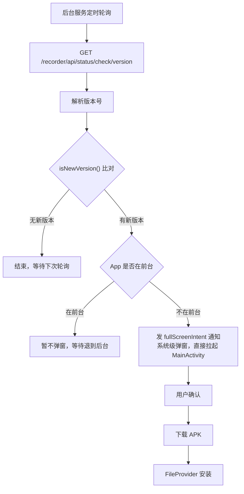

> 场景：后台服务检测到新版本，需要把 App 界面强制弹到用户面前，引导完成 APK 更新。在 Android 10 之前一行 `startActivity` 就能解决，Android 10 之后直接失效——本文记录我们的完整解决方案。

## 问题：Android 10 的后台启动限制 ##

从 Android 10（API 29）开始，系统禁止应用在后台直接 `startActivity()`。后台服务里调用启动 Activity 不会有任何报错，但界面就是不出来——logcat 里只有一行容易被忽略的：

```txt
Background activity start [callingPackage: ...] blocked
```

官方给出的合法替代方案是：*发送一条高优先级的全屏 Intent 通知（full-screen intent notification）*。来电、闹钟应用走的就是这个机制。

## 完整的版本检查 + 强拉流程 ##



## 版本比对的一个小工具 ##

版本号格式是 `1.2` 这种"大版本.小版本"，比对时去掉前缀 `v` 再分段比较：

```java
fun isNewVersion(newVersionName: String?): Boolean {
    var result = false
    try {
        if (!newVersionName.isNullOrEmpty()) {
            val vn = newVersionName.replace("v", "")
            val newBigVersion = vn.split(".")[0]
            val newSmallVersion = vn.split(".")[1]
            val curVersionName = getVersionName()
            val curBigVersion = curVersionName.split(".")[0]
            val curSmallVersion = curVersionName.split(".")[1]
            if (newBigVersion > curBigVersion) {
                result = true
            } else if (newSmallVersion > curSmallVersion) {
                result = true
            }
        }
    } catch (e: Exception) {
        result = false // 任何解析异常都视为无更新，避免误判
    }
    return result
}
```

> 一个提醒：上面用字符串比较（`"10" > "2"` 是 false），版本号位数超过 9 时会出问题。生产环境建议改成 `toInt()` 后比较，或者用 `versionCode` 比对。这里保留了项目原始实现作为反面教材，大家引以为戒。

## 核心：fullScreenIntent 拉起 Activity ##

```java
private fun startLaunchActivity(context: Context) {
    val launchIntent = context.packageManager
        .getLaunchIntentForPackage(context.packageName) ?: return

    if (Build.VERSION.SDK_INT >= Build.VERSION_CODES.Q) {
        // Android 10+：走全屏 Intent 通知
        val notificationManager =
            context.getSystemService(Context.NOTIFICATION_SERVICE) as NotificationManager

        // 没有通知权限就直接放弃（静默失败，不影响后台服务）
        if (!notificationManager.areNotificationsEnabled()) return

        // 高重要性通知渠道（Android 8.0+ 必需）
        val channel = NotificationChannel(
            "launch_channel", "应用启动", NotificationManager.IMPORTANCE_HIGH
        )
        channel.lockscreenVisibility = Notification.VISIBILITY_PUBLIC
        notificationManager.createNotificationChannel(channel)

        val fullScreenIntent = Intent(context, MainActivity::class.java).apply {
            addFlags(
                Intent.FLAG_ACTIVITY_NEW_TASK or
                Intent.FLAG_ACTIVITY_CLEAR_TASK or
                Intent.FLAG_ACTIVITY_RESET_TASK_IF_NEEDED
            )
        }

        // Android 12+ 必须显式指定 FLAG_IMMUTABLE / FLAG_MUTABLE
        val flags = if (Build.VERSION.SDK_INT >= Build.VERSION_CODES.S) {
            PendingIntent.FLAG_UPDATE_CURRENT or PendingIntent.FLAG_IMMUTABLE
        } else {
            PendingIntent.FLAG_UPDATE_CURRENT
        }

        val fullScreenPendingIntent =
            PendingIntent.getActivity(context, 1, fullScreenIntent, flags)

        val notificationBuilder = Notification.Builder(context, "launch_channel")
            .setSmallIcon(R.mipmap.app_icon)
            .setContentTitle("记录仪管理程序更新")
            .setContentText("检查到程序更新")
            // 关键 1：伪装成来电类别，获得最高展示优先级
            .setCategory(Notification.CATEGORY_CALL)
            // 关键 2：设置全屏 Intent，锁屏/后台时直接弹出 Activity
            .setFullScreenIntent(fullScreenPendingIntent, true)
            .setAutoCancel(true)

        val notification = notificationBuilder.build()
        notificationManager.notify(2, notification)

        // 双保险：500ms 后再尝试直接 startActivity
        // （某些定制 ROM 上全屏通知只横幅展示，这里兜底）
        Handler(Looper.getMainLooper()).postDelayed({
            try {
                context.startActivity(fullScreenIntent)
            } catch (e: Exception) {
                // 被系统拦截则忽略，通知还在
            }
        }, 500)
    } else {
        // Android 10 以下：直接启动即可
        launchIntent.flags =
            Intent.FLAG_ACTIVITY_NEW_TASK or Intent.FLAG_ACTIVITY_CLEAR_TASK
        context.startActivity(launchIntent)
    }
}
```

### 版本适配清单 ###

| 版本 | 要注意的点 |
| --- | --- |
| Android 8.0+ | 必须创建 NotificationChannel，`IMPORTANCE_HIGH` 才有横幅 |
| Android 10+ | 后台禁止 startActivity，必须用 `setFullScreenIntent` |
| Android 12+ | PendingIntent 必须显式声明 `FLAG_IMMUTABLE` |
| Android 13+ | 通知需要运行时权限 `POST_NOTIFICATIONS`，先检查 `areNotificationsEnabled()` |
| Android 14+ | 全屏 Intent 默认只授予来电/闹钟类应用，其他应用需用户授权 `USE_FULL_SCREEN_INTENT` |


## 下载与安装 ##

用户确认后进入下载安装流程。用系统 `DownloadManager` 实现最简单，不需要自己处理断网和通知栏进度：

```java
fun downloadAndInstallApk(apkUrl: String) {
    // Android 8.0+ 需要"安装未知应用"权限
    if (Build.VERSION.SDK_INT >= Build.VERSION_CODES.O &&
        !context.packageManager.canRequestPackageInstalls()
    ) {
        context.startActivity(
            Intent(Settings.ACTION_MANAGE_UNKNOWN_APP_SOURCES).apply {
                data = Uri.parse("package:${context.packageName}")
            }
        )
        return
    }

    val outputFile = File(
        File(context.getExternalFilesDir(null), "apks").apply { mkdirs() },
        "update.apk"
    )

    val request = DownloadManager.Request(Uri.parse(apkUrl)).apply {
        setTitle("应用更新")
        setNotificationVisibility(DownloadManager.Request.VISIBILITY_VISIBLE)
        setDestinationUri(Uri.fromFile(outputFile))
        setAllowedOverMetered(true) // 允许流量下载
    }

    val downloadManager =
        context.getSystemService(Context.DOWNLOAD_SERVICE) as DownloadManager
    val downloadId = downloadManager.enqueue(request)

    // 广播监听下载完成后触发安装
    val receiver = object : BroadcastReceiver() {
        override fun onReceive(context: Context, intent: Intent) {
            val id = intent.getLongExtra(DownloadManager.EXTRA_DOWNLOAD_ID, -1)
            if (id == downloadId) {
                installApk(outputFile)
                context.unregisterReceiver(this)
            }
        }
    }
    ContextCompat.registerReceiver(
        context, receiver,
        IntentFilter(DownloadManager.ACTION_DOWNLOAD_COMPLETE),
        ContextCompat.RECEIVER_NOT_EXPORTED // Android 13+ 必须显式声明导出标志
    )
}
```

安装环节唯一的坑是 Android 7.0 的 FileProvider：

```java
private fun installApk(apkFile: File) {
    val intent = Intent(Intent.ACTION_VIEW).apply {
        addFlags(Intent.FLAG_ACTIVITY_NEW_TASK)
        addFlags(Intent.FLAG_GRANT_READ_URI_PERMISSION)
        val uri = FileProvider.getUriForFile(
            context, "${context.packageName}.fileprovider", apkFile
        )
        setDataAndType(uri, "application/vnd.android.package-archive")
    }
    context.startActivity(intent)
}
```

配合 `res/xml/file_paths.xml` 和 `Manifest` 里的 `<provider>` 声明即可。别忘了覆盖安装完成后用上一篇提到的 `MY_PACKAGE_REPLACED` 广播把后台服务拉起来，形成闭环。

## 总结 ##

完整链路的几个关键点：

- 版本比对要容错，解析失败一律视为无更新；
- Android 10+ 后台弹界面只有 fullScreenIntent 一条正路，CATEGORY_CALL + IMPORTANCE_HIGH 是体验最好的组合；
- Android 12/13/14 各有新权限坑（IMMUTABLE、通知权限、全屏 Intent 权限），都要做检查与降级；
- 下载用系统 DownloadManager + FileProvider 安装，代码量最小且行为合规；
- 安装完成后记得用更新广播重启后台服务。

这套流程在定制工业终端上稳定运行，如果你的目标设备是普通手机，Android 14 的全屏 Intent 权限会是主要障碍，建议降级为普通高优先级通知 + 用户点击跳转。
