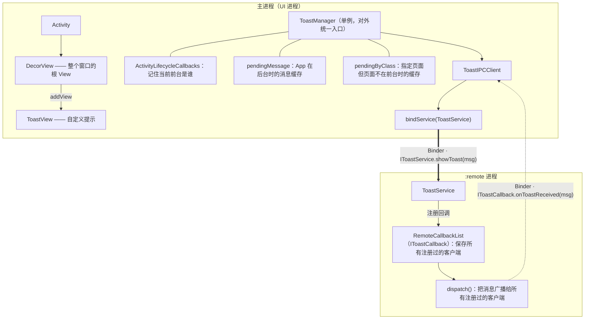

> 本文基于一个真实 MVVM 项目（Kotlin + ViewBinding），完整讲解如何手写一个"长得像 Toast、但完全可控、还能跨进程调用"的消息提示组件。
> 全文采用 *代码* + *逐行注释* 的方式展开，所有代码均可直接运行。

## 为什么要自己写 Toast ##

系统 `Toast` 有几个绕不开的限制：

| 问题 | 说明 |
| :--- | :--- |
| 样式不可控 | 只能改文字，背景、圆角、字体都要靠反射或自定义 View 塞进去 |
| 动画不可控 | 系统固定淡入淡出，无法定制 |
| Android 11+ 限制 | 后台弹出自定义 Toast 被限制，`Toast.setView()` 已废弃 |
| 多进程无解 | 后台进程（推送/下载/播放）**没有 Activity**，根本没法往主进程页面上弹东西 |


所以我们的目标是一个同时满足下面几点的组件：

- 外观完全自定义（圆角、半透明、动画、时长全可控）
- 不需要悬浮窗权限（不申请 `SYSTEM_ALERT_WINDOW`）
- 支持跨进程调用（后台进程 → 主进程 UI）
- 支持指定页面延迟显示（"等用户回到首页再提示"）

## 整体架构 ##




设计上刻意模仿系统的 `NotificationManagerService`：消息不是直接画出来的，而是先发给一个"服务"，再由服务回调回来渲染。这样后台进程只需 `show()` 一下，UI 进程自然就弹了。

## 第一层：自定义 View —— `ToastView` ##

这是最基础的"长得像 Toast 的东西"。

### 圆角背景 ###

```xml
<!-- res/drawable/bg_toast_view.xml -->
<?xml version="1.0" encoding="utf-8"?>
<shape xmlns:android="http://schemas.android.com/apk/res/android"
    android:shape="rectangle">
​
    <!-- CC = 80% 不透明度，黑底白字，和系统 Toast 观感接近 -->
    <solid android:color="#CC000000" />
​
    <!-- 圆角半径，让提示看起来不那么生硬 -->
    <corners android:radius="20dp" />
​
</shape>
```

### View 本体 ###

```java
package net.cmono.mvvm.ui.view
​
import android.content.Context
import android.graphics.Color
import android.util.AttributeSet
import android.view.Gravity
import android.widget.FrameLayout
import android.widget.TextView
import net.cmono.mvvm.R
​
/**
 * 自定义 Toast 提示 View
 *
 * 设计要点：
 * - 纯代码构建，不依赖任何 layout.xml，可以直接 addView 到任意 ViewGroup
 * - 圆角半透明黑底 + 白字，视觉与系统 Toast 接近
 * - 淡入 -> 停留 -> 淡出，动画结束后通过 onDismiss 通知外部移除自己
 * - 自身不消费触摸事件，不会挡住下层页面的点击
 */
class ToastView @JvmOverloads constructor(
    context: Context,
    attrs: AttributeSet? = null,
    defStyleAttr: Int = 0
) : FrameLayout(context, attrs, defStyleAttr) {
​
    private val tvMessage: TextView
    private var dismissRunnable: Runnable? = null
​
    /** 淡出动画结束的回调：外部在这里把自己从父容器移除 */
    var onDismiss: (() -> Unit)? = null
​
    init {
        // 关键：不拦截触摸事件。
        // 否则这块区域会吃掉点击事件，用户点不到下面的列表
        isClickable = false
​
        tvMessage = TextView(context).apply {
            setTextColor(Color.WHITE)
            textSize = 14f
            gravity = Gravity.CENTER
            setBackgroundResource(R.drawable.bg_toast_view)
            // 限制最大宽度：长文案会自动换行，不会撑满整屏
            maxWidth = (260 * resources.displayMetrics.density).toInt()
            val pad = (12 * resources.displayMetrics.density).toInt()
            setPadding(pad * 2, pad, pad * 2, pad)
        }
        addView(
            tvMessage,
            LayoutParams(LayoutParams.WRAP_CONTENT, LayoutParams.WRAP_CONTENT, Gravity.CENTER)
        )
        // 初始透明，等 show() 时再做淡入
        alpha = 0f
    }
​
    fun setMessage(text: CharSequence) {
        tvMessage.text = text
    }
​
    /**
     * 开始显示：淡入 -> 停留 duration 毫秒 -> 淡出
     */
    fun show(duration: Long = DEFAULT_DURATION) {
        // 重复调用时，先把上一条的定时消失任务取消掉，避免叠加
        removeCallbacks(dismissRunnable)
        animate().cancel()
​
        // 每次都从"透明 + 下移 40dp"开始，保证动画起点一致
        alpha = 0f
        translationY = 40f
        animate()
            .alpha(1f)
            .translationY(0f)
            .setDuration(ANIM_DURATION)
            .start()
​
        // 定时执行淡出
        dismissRunnable = Runnable { dismiss() }
        postDelayed(dismissRunnable, duration)
    }
​
    private fun dismiss() {
        animate()
            .alpha(0f)
            .translationY(40f)
            .setDuration(ANIM_DURATION)
            // withEndAction：动画真正结束后才回调，此时移除 View 才安全
            .withEndAction { onDismiss?.invoke() }
            .start()
    }
​
    override fun onDetachedFromWindow() {
        // 页面销毁 / 被外部移除时，务必取消定时任务，
        // 否则 Runnable 会持有本 View 引用直到触发，造成短时间泄漏
        removeCallbacks(dismissRunnable)
        super.onDetachedFromWindow()
    }
​
    companion object {
        private const val ANIM_DURATION = 250L
        private const val DEFAULT_DURATION = 2000L
    }
}
```

几个容易忽略的点：

- `isClickable = false` —— 不加的话，提示区域会拦截点击，用户会以为页面卡了
- `maxWidth` —— 不加的话，一句长文案能横穿整个屏幕
- `onDetachedFromWindow` 里 `removeCallbacks` —— `postDelayed` 的 `Runnable` 挂在 `View` 的消息队列上，不移除会泄漏

## 第二层：显示管理 —— `ToastManager` ##

这一层解决三个问题：*挂到哪、挂给谁、什么时候挂*。

### 为什么挂在 `DecorView`，而不是 `WindowManager` ###

常见做法是 `WindowManager.addView()` 加一个系统窗口，但那需要 `SYSTEM_ALERT_WINDOW` 权限，Android 6.0+ 还要跳设置页手动授权，体验很差。

我们改用 `Activity.window.decorView.addView()` ：

- `DecorView` 是整个窗口的根 `View`，挂在它上面天然覆盖所有内容
- 属于应用内窗口，不需要任何权限
- 随 `Activity` 销毁自动回收，不需要手动管理 `Window`

### 完整实现 ###

```java
package net.cmono.mvvm.utils
​
import android.app.Activity
import android.app.Application
import android.os.Bundle
import android.util.Log
import android.view.Gravity
import android.view.ViewGroup
import android.widget.FrameLayout
import net.cmono.mvvm.ipc.ToastIPCClient
import net.cmono.mvvm.ui.view.ToastView
import java.util.concurrent.ConcurrentHashMap
​
object ToastManager {
​
    private const val TAG = "ToastManager"
​
    /** 当前处于前台（resumed）的 Activity */
    @Volatile
    private var currentActivity: Activity? = null
​
    /** App 退到后台期间收到的最后一条消息，回前台后补显示 */
    @Volatile
    private var pendingMessage: String? = null
​
    /**
     * 按类名缓存的待显示消息。
     * key = Activity 全限定类名，同一页面只保留最后一条。
     * 用 ConcurrentHashMap：showOn 可能从 Binder 线程调用，
     * 而 onActivityResumed 在主线程，必须保证线程安全。
     */
    private val pendingByClass = ConcurrentHashMap<String, String>()
​
    private var initialized = false
​
    /**
     * 在 Application.onCreate() 里调用一次即可
     */
    fun init(application: Application) {
        if (initialized) return
        initialized = true
​
        // ★ 核心：全局监听所有 Activity 的生命周期。
        // 有了它，调用方完全不需要知道"当前是哪个页面"
        application.registerActivityLifecycleCallbacks(object :
            Application.ActivityLifecycleCallbacks {
​
            override fun onActivityResumed(activity: Activity) {
                currentActivity = activity
​
                // 该页面回到前台：取出之前指定给它、但它不在前台时缓存的消息
                // 用 remove() 而不是 get()，取完就删，保证只显示一次
                pendingByClass.remove(activity.javaClass.name)?.let { cached ->
                    show(activity, cached)
                }
​
                // 取出 App 在后台期间缓存的消息
                pendingMessage?.let { cached ->
                    pendingMessage = null
                    show(activity, cached)
                }
            }
​
            override fun onActivityPaused(activity: Activity) {
                // 用 === 比地址：避免不同 Activity 实例误清空
                if (currentActivity === activity) currentActivity = null
            }
​
            override fun onActivityDestroyed(activity: Activity) {
                if (currentActivity === activity) currentActivity = null
                // 页面都销毁了，留给它的消息没必要再留着
                pendingByClass.remove(activity.javaClass.name)
            }
​
            // 以下用不到，空实现即可
            override fun onActivityCreated(activity: Activity, savedInstanceState: Bundle?) {}
            override fun onActivityStarted(activity: Activity) {}
            override fun onActivityStopped(activity: Activity) {}
            override fun onActivitySaveInstanceState(activity: Activity, outState: Bundle) {}
        })
​
        // 绑定远程服务，并订阅远程回传的消息
        ToastIPCClient.bind(application)
        ToastIPCClient.addListener { message -> show(message) }
        Log.d(TAG, "ToastManager initialized")
    }
​
    /**
     * 在当前前台 Activity 上显示（最常用）
     */
    fun show(message: String) {
        show(currentActivity, message)
    }
​
    /**
     * 在指定 Activity 上显示 —— 真正的渲染逻辑都在这里
     */
    fun show(activity: Activity?, message: String) {
        val act = activity
​
        // App 在后台 / 页面切换中 / Activity 正在销毁时，
        // 不丢弃消息，而是缓存最后一条，等页面回前台再补显示
        if (act == null || act.isFinishing) {
            Log.w(TAG, "no foreground activity, cache message: $message")
            pendingMessage = message
            return
        }
​
        // 可能从 Binder 线程进来，统一切回主线程操作 UI
        act.runOnUiThread {
            val parent = act.window.decorView as? ViewGroup ?: return@runOnUiThread
​
            // 移除上一条还没消失的提示，避免多条叠加成一坨
            // 倒序遍历：正序遍历时 removeView 会改变索引导致漏删
            for (i in parent.childCount - 1 downTo 0) {
                val child = parent.getChildAt(i)
                if (child is ToastView) parent.removeView(child)
            }
​
            val toastView = ToastView(act)
            toastView.setMessage(message)
​
            // 底部居中，距离底部 80dp，位置和系统 Toast 接近
            val params = FrameLayout.LayoutParams(
                FrameLayout.LayoutParams.WRAP_CONTENT,
                FrameLayout.LayoutParams.WRAP_CONTENT
            ).apply {
                gravity = Gravity.BOTTOM or Gravity.CENTER_HORIZONTAL
                bottomMargin = (80 * act.resources.displayMetrics.density).toInt()
            }
​
            // 动画结束后把自己摘掉，不留残留 View
            toastView.onDismiss = { parent.removeView(toastView) }
            parent.addView(toastView, params)
            toastView.show()
        }
    }
​
    /**
     * 指定某个 Activity 显示 —— 手上没有目标实例时用这个
     *
     * 例：ToastManager.showOn(MainActivity::class.java, "下载完成了")
     *
     * 三种行为：
     * - 目标页面正好在前台        -> 立即显示
     * - 目标页面不在前台（在后台栈里 / 还没创建）-> 缓存，等它 resume 时显示
     * - 目标页面被销毁            -> 缓存清除，不再显示
     */
    fun showOn(clazz: Class<out Activity>, message: String) {
        val foreground = currentActivity
​
        // ★ 判断条件必须是"正在前台"，不能只是"实例还存在"
        // 如果只判断实例存在：MainActivity 压在后台栈里还活着，
        // 会立刻给它挂上 View，但用户根本看不到（当前显示的是别的页面），
        // 2 秒后 Toast 已经消失，等于白弹一次
        if (foreground != null && foreground.javaClass == clazz && !foreground.isFinishing) {
            show(foreground, message)
            return
        }
​
        Log.d(TAG, "${clazz.simpleName} not in foreground, cache message: $message")
        pendingByClass[clazz.name] = message
    }
​
    /**
     * 走完整 IPC 链路：
     * 本进程 -> Binder -> :remote 进程 -> Binder 回调 -> 本进程 -> ToastView
     */
    fun showViaIpc(message: String) {
        ToastIPCClient.show(message)
    }
}
```

### 三种指定目标的方式 ###

```java
// ① 自动跟随当前页面（最常用，不需要知道是谁）
ToastManager.show("登录成功")
​
// ② 手上有 Activity 实例（在页面内部使用）
ToastManager.show(this, "保存成功")
​
// ③ 只知道类名（跨页面场景）
ToastManager.showOn(MainActivity::class.java, "下载完成了")
```

## 第三层：跨进程 IPC（AIDL + Binder） ##

### 为什么需要"双向"IPC ###

单向 IPC（主进程 → 远程进程）解决不了问题：消息到了远程进程，那里没有 Activity，还是弹不出来。

正确做法是双向：

- 主进程 `showToast(msg)` → 远程进程
- 远程进程广播 → 所有注册过回调的客户端
- 主进程的回调收到消息 → 渲染 `ToastView`

这样后台进程只要调一次 `show()`，UI 进程自动就弹了。

### 定义 AIDL 接口 ###

AIDL 文件必须放在 `src/main/aidl/` 下，包名要和 Java/Kotlin 代码一致。

```java
// src/main/aidl/com/jzh/mvvm/ipc/IToastCallback.aidl
package net.cmono.mvvm.ipc;
​
/**
 * 回调接口：远程 Service 通过它把消息回传给客户端进程
 */
interface IToastCallback {
    // 非基本类型参数必须标明方向：in 表示数据流向服务端
    void onToastReceived(in String message);
}
```

```java
// src/main/aidl/com/jzh/mvvm/ipc/IToastService.aidl
package net.cmono.mvvm.ipc;
​
// 即使同包，AIDL 也要求显式 import
import net.cmono.mvvm.ipc.IToastCallback;
​
/**
 * 跨进程 Toast 服务（对应系统里的 NotificationManagerService）
 */
interface IToastService {
​
    /** 发一条消息，服务端会广播给所有已注册的客户端 */
    void showToast(in String message);
​
    /** 注册回调 */
    void registerCallback(IToastCallback callback);
​
    /** 解注册回调 */
    void unregisterCallback(IToastCallback callback);
}
```

> 坑点：AIDL 里非基本类型参数必须写方向标签 `in` / `out` / `inout`，String 也不例外。即使两个 `aidl` 文件在同一个包，`import` 也不能省。

### 服务端：ToastService（运行在 `:remote` 进程） ###

```java
package net.cmono.mvvm.ipc
​
import android.app.Service
import android.content.Intent
import android.os.*
import android.util.Log
import androidx.annotation.RequiresApi
​
/**
 * 运行在 :remote 进程的跨进程 Toast 服务
 */
class ToastService : Service() {
​
    companion object {
        private const val TAG = "ToastService"
    }
​
    /**
     * ★ 必须用 RemoteCallbackList，不能用普通 ArrayList<IToastCallback>：
     * 1. 它以 IBinder 为 key，客户端进程死亡后能自动清理
     * 2. 普通 List 持有的其实是 Binder 代理对象，客户端死了会留下僵尸回调
     * 3. AIDL 里同一个对象跨进程传递可能被反序列化成不同实例，
     *    RemoteCallbackList 按 Binder 身份去重，普通 List 做不到
     */
    private val callbacks = RemoteCallbackList<IToastCallback>()
​
    private val binder = object : IToastService.Stub() {
​
        override fun showToast(message: String?) {
            Log.d(TAG, "[remote pid=${Process.myPid()}] showToast: $message")
            dispatch(message)
        }
​
        @RequiresApi(Build.VERSION_CODES.JELLY_BEAN_MR1)
        override fun registerCallback(callback: IToastCallback?) {
            if (callback == null) return
            callbacks.register(callback)
            Log.d(TAG, "registerCallback, count=${callbacks.registeredCallbackCount}")
        }
​
        @RequiresApi(Build.VERSION_CODES.JELLY_BEAN_MR1)
        override fun unregisterCallback(callback: IToastCallback?) {
            if (callback == null) return
            callbacks.unregister(callback)
            Log.d(TAG, "unregisterCallback, count=${callbacks.registeredCallbackCount}")
        }
    }
​
    /**
     * 广播消息给所有客户端。
     * 注意：本方法运行在 Binder 线程池，不是主线程！
     * 客户端收到回调后必须自己切回主线程才能更新 UI。
     */
    private fun dispatch(message: String?) {
        if (message.isNullOrEmpty()) return
​
        // beginBroadcast / finishBroadcast 必须成对调用，
        // 中间拿到的才是稳定的快照
        val count = callbacks.beginBroadcast()
        for (i in 0 until count) {
            try {
                callbacks.getBroadcastItem(i).onToastReceived(message)
            } catch (e: RemoteException) {
                // 单个客户端挂了不能影响其他客户端
                Log.e(TAG, "dispatch callback failed", e)
            }
        }
        callbacks.finishBroadcast()
    }
​
    override fun onBind(intent: Intent): IBinder = binder
​
    override fun onDestroy() {
        // 释放内部持有的所有回调引用
        callbacks.kill()
        super.onDestroy()
    }
}
```

### 客户端：ToastIPCClient ###

```java
package net.cmono.mvvm.ipc
​
import android.content.ComponentName
import android.content.Context
import android.content.Intent
import android.content.ServiceConnection
import android.os.Handler
import android.os.IBinder
import android.os.Looper
import android.os.RemoteException
import android.util.Log
​
/**
 * 对上层屏蔽 AIDL / Binder 细节，只暴露 bind / show / addListener
 */
object ToastIPCClient {
​
    private const val TAG = "ToastIPCClient"
​
    // ★ AIDL 回调运行在 Binder 线程，必须切回主线程才能操作 UI
    private val mainHandler = Handler(Looper.getMainLooper())
​
    @Volatile
    private var service: IToastService? = null
​
    @Volatile
    private var bound = false
​
    private val listeners = mutableListOf<(String) -> Unit>()
​
    /** 传给远程进程的回调对象 */
    private val callback = object : IToastCallback.Stub() {
        override fun onToastReceived(message: String?) {
            Log.d(TAG, "[main pid=${android.os.Process.myPid()}] onToastReceived: $message")
            if (message.isNullOrEmpty()) return
​
            mainHandler.post {
                // toList() 拷贝一份再遍历：
                // 防止遍历过程中有其他线程 add/remove 导致 ConcurrentModificationException
                listeners.toList().forEach { listener -> listener.invoke(message) }
            }
        }
    }
​
    private val connection = object : ServiceConnection {
        override fun onServiceConnected(name: ComponentName?, binder: IBinder?) {
            // asInterface：把 IBinder 转成业务接口代理
            // 如果服务在另一个进程，返回的是代理对象；同进程则直接返回实现
            service = binder?.let { IToastService.Stub.asInterface(it) }
            bound = service != null
            try {
                service?.registerCallback(callback)
                Log.d(TAG, "onServiceConnected: $name")
            } catch (e: RemoteException) {
                Log.e(TAG, "registerCallback failed", e)
            }
        }
​
        override fun onServiceDisconnected(name: ComponentName?) {
            // 远程进程被杀时回调，此时 service 已失效
            service = null
            bound = false
            Log.w(TAG, "onServiceDisconnected: $name")
        }
    }
​
    /**
     * 绑定远程服务。
     * 用 applicationContext 绑定，绝不能传 Activity，否则会泄漏整个页面
     */
    fun bind(context: Context) {
        if (bound) return
        val appContext = context.applicationContext ?: return
        try {
            appContext.bindService(
                Intent(appContext, ToastService::class.java),
                connection,
                Context.BIND_AUTO_CREATE   // 服务不存在时自动创建
            )
        } catch (e: Exception) {
            Log.e(TAG, "bindService failed", e)
        }
    }
​
    fun unbind(context: Context) {
        if (!bound) return
        val appContext = context.applicationContext ?: return
        try {
            service?.unregisterCallback(callback)
        } catch (e: RemoteException) {
            Log.e(TAG, "unregisterCallback failed", e)
        }
        try {
            appContext.unbindService(connection)
        } catch (e: Exception) {
            Log.e(TAG, "unbindService failed", e)
        }
        service = null
        bound = false
    }
​
    /**
     * 发消息到远程进程。
     * 远程会再广播回来，真正显示由 listeners 收到回调后触发 —— 这才是完整的双向 IPC
     */
    fun show(message: String) {
        val svc = service
        if (svc == null) {
            Log.w(TAG, "service not connected yet, message dropped: $message")
            return
        }
        try {
            svc.showToast(message)
        } catch (e: RemoteException) {
            Log.e(TAG, "showToast failed", e)
        }
    }
​
    fun isConnected(): Boolean = bound && service != null
​
    fun addListener(listener: (String) -> Unit) {
        mainHandler.post { listeners.add(listener) }
    }
​
    fun removeListener(listener: (String) -> Unit) {
        mainHandler.post { listeners.remove(listener) }
    }
}
```

## 接入项目 ##

### Manifest 声明服务（指定独立进程） ###

```xml
<application ...>
​
    <!-- android:process=":remote" 让服务运行在独立进程，
         这样才能真正验证跨进程；":xxx" 表示私有进程，其他 App 无法访问 -->
    <service
        android:name=".ipc.ToastService"
        android:process=":remote"
        android:exported="false" />
​
</application>
```


### Application 初始化（★ 必须判断主进程） ###

```java
class BaseApplication : Application() {
​
    override fun onCreate() {
        super.onCreate()
        // ...其他初始化...
​
        // ★ 只在主进程初始化，避免 :remote 进程自己回调自己形成死循环
        if (isMainProcess()) {
            ToastManager.init(this)
        }
    }
​
    /**
     * Application.onCreate() 在【每个进程】都会执行一次。
     * 如果 :remote 进程也去 bind 服务并注册回调，
     * 它发出的消息会广播回自己，再显示、再发送……无限循环。
     */
    private fun isMainProcess(): Boolean {
        val pid = Process.myPid()
        val am = getSystemService(Context.ACTIVITY_SERVICE) as? ActivityManager
        am?.runningAppProcesses?.forEach { info ->
            if (info.pid == pid) {
                // 主进程的进程名就是包名，:remote 进程是 "包名:remote"
                return info.processName == packageName
            }
        }
        return false
    }
}
```

### 业务侧调用 ###

```java
// 直接显示（不走 IPC）
rl_toast_normal.setOnClickListener {
    ToastManager.show("这是一条直接显示的自定义提示")
}
​
// 跨进程显示：当前页面立即弹出
rl_toast_ipc.setOnClickListener {
    ToastManager.showViaIpc("这条消息走了 :remote 进程再回调回来")
}
​
// 指定 MainActivity：不在前台则缓存，等回到首页才显示
rl_toast_on_main.setOnClickListener {
    ToastManager.showOn(MainActivity::class.java, "下载完成了")
}
```

## 踩过的坑（都是真金白银换来的） ##

### 坑 1：`Application.onCreate` 每个进程都会跑 ###

不加 `isMainProcess()` 判断，`:remote` 进程也会注册回调，消息发给自己 → 再发 → 死循环。

### 坑 2：AIDL 回调在 Binder 线程 ###

`onToastReceived()` 不在主线程，直接更新 UI 会崩。必须用 `Handler(Looper.getMainLooper()).post {}` 切回去。

### 坑 3：RemoteCallbackList 必须成对调用 ###

```java
val count = callbacks.beginBroadcast()   // 开始
// ... 遍历 ...
callbacks.finishBroadcast()              // 结束，漏了会导致状态错乱
```

### 坑 4：判断"目标页面存在"≠"目标页面可见" ###

`showOn()` 最初的实现是"只要 `Activity` 实例还活着就立即显示"。结果：`MainActivity` 压在后台栈里确实活着，Toast 立刻挂上去，但用户在别的页面根本看不到，2 秒后 Toast 自己消失了 —— 消息凭空丢失。

正确做法是判断"目标 Activity 是不是 `currentActivity`"，不是就缓存，等它 `onResume`。

### 坑 5：倒序遍历移除 View ###

```java
// 正序删除会因为索引位移而漏删，必须倒序
for (i in parent.childCount - 1 downTo 0) { ... }
```

### 坑 6：不要用 WindowManager ###

`WindowManager.addView()` 加系统窗口要 `SYSTEM_ALERT_WINDOW` 权限，Android 6.0+ 还得跳设置页授权。用 `decorView.addView()` 完全不需要权限。

## 扩展：后台进程怎么用 ##

当前只有主进程 `bind` 了服务。如果 `:push`、`:download` 这类后台进程也想发消息，它们需要自己 `bind` 一次（但不要 `addListener`，否则又会自己接自己的消息）：

```java
// :download 进程（该进程没有 Activity）
class DownloadService : Service() {
​
    override fun onCreate() {
        super.onCreate()
        // 只 bind（获得发送能力），不 addListener（不接收，避免自己显示自己）
        ToastIPCClient.bind(this)
    }
​
    private fun onDownloadFinished() {
        // 本进程无法弹 UI，交给主进程显示
        ToastIPCClient.show("下载完成了")
    }
}
```

这里正好体现了 "发送"和"接收"是两件独立的事：

- `bind()` → 获得发送能力
- `addListener()` → 获得接收显示能力

后台进程只用前者，主进程两者都用。

## 总结 ##

| 层次 | 组件 | 职责 |
| :--- | :--- | :--- |
| View 层 | `ToastView` | 外观与动画，纯代码构建，不消费触摸事件 |
| 管理层 | `ToastManager` | 跟踪前台 Activity、管理缓存、挂载到 DecorView |
| IPC 层 | AIDL + `ToastService` + `ToastIPCClient` | 跨进程双向通信 |
| 接入层 | Manifest + Application | 声明 `:remote` 进程、主进程判断 |

三个核心设计决策：

- 挂 DecorView 而不是 WindowManager —— 零权限
- `ActivityLifecycleCallbacks` 跟踪前台 —— 零侵入，调用方不用关心当前页面
- `showOn` 判断"是否在前台"而不是"是否存在" —— 保证延迟消息不丢失

如果只做单进程提示，其实只要 `ToastView` + `ToastManager` 两层就够了；IPC 层是为多进程架构准备的，理解它的关键是 "发送"和"接收"要分开。
