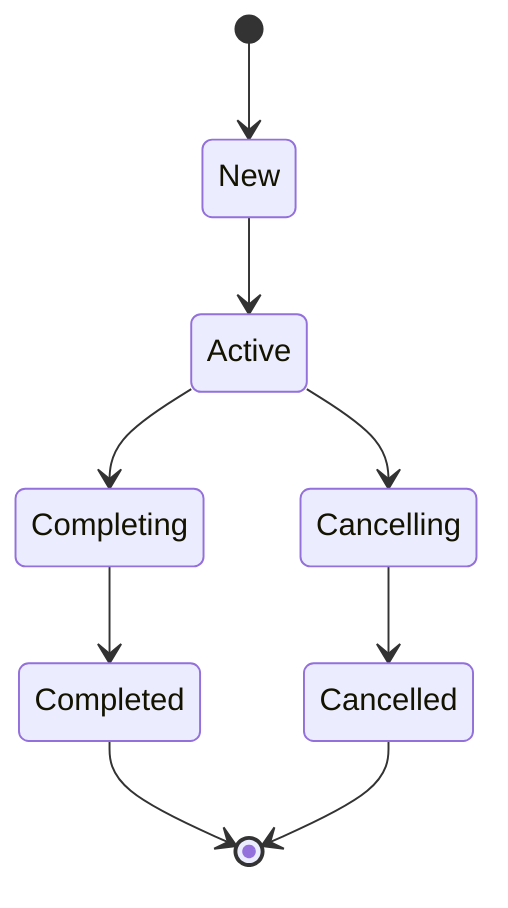

## 协程不是线程，但运行在线程上 ##

很多人把协程理解成“轻量级线程”，这话对了一半。

准确说：*协程是代码执行的“可挂起计算单元”* ，它可以被调度到线程上执行，也可以在不阻塞线程的情况下挂起。

### 挂起的本质 ###

```java
suspend fun fetchData(): String = withContext(Dispatchers.IO) {
    // 网络请求
    api.getData()
}
```

`withContext` 挂起时：

- 当前协程让出线程。
- 线程回去执行其他协程或事件循环。
- IO 完成后，协程被恢复到可用线程继续执行。

*线程没有被阻塞*，只是协程被暂停了。

### 线程池模型 ###

Kotlin 协程默认提供三种 Dispatchers：

| Dispatcher | 线程模型 | 用途 |
| :--- | :--- | :--- |
| `Dispatchers.Main` | 主线程 Looper | UI 更新 |
| `Dispatchers.Default` | CPU 核数线程池 | 计算密集型 |
| `Dispatchers.IO` | 默认 64 线程池 | IO 密集型 |


注意：`Default` 线程数 = CPU 核心数，`IO` 线程数 = `max(64, CPU核数 * 2)`。

## Dispatchers 的源码差异 ##

### Default 和 IO 共享线程池吗？ ###

Kotlin 协程内部对 Default 和 IO 做了统一调度，但 *IO 允许更多线程*。

```java
// 简化理解
internal object DefaultScheduler : Scheduler() {
    val IO: CoroutineDispatcher = LimitingDispatcher(
        corePoolSize = 0,
        maxPoolSize = 64,
        idleKeepAliveMs = 60_000L,
        name = "Dispatchers.IO"
    )
}
```

`Dispatchers.IO` 在任务量增大时会创建更多线程，避免 IO 等待阻塞整个线程池。

### 混淆点：IO 上能不能做 CPU 计算？ ###

能，但不推荐。因为 `Dispatchers.IO` 设计目标是处理阻塞式 IO，不是密集型计算。大量计算应该放在 `Dispatchers.Default`。

### `Main.immediate` 和 `Main` 的区别 ###

```java
// Dispatchers.Main.immediate
withContext(Dispatchers.Main.immediate) {
    // 如果已经在主线程，不投递到 Looper，直接执行
}

withContext(Dispatchers.Main) {
    // 即使已经在主线程，也会 post 到 Looper 队列尾部
}
```

`Main.immediate` 可以减少一次 Handler post，响应更快。但要注意：如果当前不在主线程，它和 `Main` 行为一致。

## Job：协程的句柄与生命周期 ##

每个 launch 或 async 都会返回一个 Job，它是协程的句柄。

### Job 的状态机 ###



- `isActive`：是否正在运行。
- `isCompleted`：是否已完成（包括正常完成和取消）。
- `isCancelled`：是否被取消。

### 结构化并发 ###

```java
val scope = CoroutineScope(Job() + Dispatchers.Main)

scope.launch {
    launch { task1() }
    launch { task2() }
}
```

子 Job 会挂载到父 Job 下。父 Job 取消时，所有子 Job 都会被取消；所有子 Job 完成后，父 Job 才算完成。

### SupervisorJob：子协程独立失败 ###

```java
val supervisor = SupervisorJob()
val scope = CoroutineScope(supervisor + Dispatchers.Main)

scope.launch {
    launch {
        throw RuntimeException("子协程 1 失败")
    }
    launch {
        delay(100)
        println("子协程 2 仍然执行")
    }
}
```

`SupervisorJob` 下，一个子协程失败不会影响其他子协程。这是 `ViewModelScope` 默认使用 `SupervisorJob` 的原因：一个数据流失败不应该把整个 ViewModel 搞崩。

## 协程异常处理：为什么有时会崩溃？ ##

协程异常处理是 Kotlin 协程里最容易踩坑的部分。

### 异常传播规则 ###

| 启动方式 | 异常传播行为 |
| :--- | :--- |
| `launch` | 异常向上传播到父协程，未处理则崩溃 |
| `async` | 异常在 `await()` 调用处抛出 |
| `supervisorScope` | 子协程异常不会取消兄弟协程 |
| `coroutineScope` | 一个子协程异常会取消所有兄弟协程 |

### 为什么 launch 会崩溃 App？ ###

```java
CoroutineScope(Dispatchers.Main).launch {
    throw RuntimeException("boom")
}
```

`launch` 的异常会向上冒泡，最终到达 `CoroutineExceptionHandler`。如果没有设置 `handler`，默认会交给线程的未捕获异常处理器，结果就是 App 崩溃。

### 正确处理异常 ###

#### 方案 1：try-catch ####

```java
viewModelScope.launch {
    try {
        riskyOperation()
    } catch (e: Exception) {
        _error.value = e.message
    }
}
```

#### 方案 2：CoroutineExceptionHandler ####

```java
val handler = CoroutineExceptionHandler { _, exception ->
    Log.e("Coroutine", "未捕获异常: ${exception.message}")
}

val scope = CoroutineScope(handler + Dispatchers.Main)
scope.launch {
    throw RuntimeException("这里会被 handler 捕获")
}
```

注意：`CoroutineExceptionHandler` 只能捕获 `launch` 抛出的未处理异常，不能捕获 `async` 里未 `await` 的异常。

### async 的异常陷阱 ###

```java
val deferred = async {
    throw RuntimeException("async 异常")
}
// 如果不调用 await()，异常会被暂存，不会立即抛出
```

只有调用 `await()` 时，异常才会抛出。这也是 `async` 更适合有返回值场景的原因。

## Flow：响应式数据流的最佳实践 ##

### Flow 是冷流 ###

```java
val flow = flow {
    emit(1)
    emit(2)
}

// 每个 collect 都会重新执行 flow 块
flow.collect { println(it) }
flow.collect { println(it) }
```

每次 `collect` 都会重新执行 `flow { }` 代码块，这是“冷流”的定义。

### StateFlow 和 SharedFlow 是热流 ###

| 类型 | 特点 | 适用场景 |
| :--- | :--- | :--- |
| `StateFlow` | 永远有最新值，新订阅者立即收到当前值 | UI 状态 |
| `SharedFlow` | 可配置 replay，没有默认值 | 事件总线、一次性通知 |

```java
// StateFlow
private val _state = MutableStateFlow(UiState.Idle)
val state: StateFlow<UiState> = _state.asStateFlow()

// SharedFlow
private val _events = MutableSharedFlow<String>()
val events: SharedFlow<String> = _events.asSharedFlow()
```

### Flow 线程切换 ###

```java
flow { emit(api.getData()) }
    .flowOn(Dispatchers.IO)   // 上游在 IO 线程执行
    .onEach { updateUi(it) }   // 下游默认仍在收集线程
    .collect()
```

`flowOn` 只影响上游操作符的线程，下游由收集者决定。通常在 `ViewModel` 里收集时，`viewModelScope.launch` 默认就是 Main 线程。

### shareIn 和 stateIn：把冷流转热 ###

```java
val result: StateFlow<Result> = repo.fetchData()
    .stateIn(
        scope = viewModelScope,
        started = SharingStarted.WhileSubscribed(5000),
        initialValue = Result.Loading
    )
```

`WhileSubscribed(5000)` 表示当最后一个订阅者消失后 5 秒再停止上游，避免配置变更时重复请求。

## 常见反模式 ##

| 反模式 | 问题 |
| :--- | :--- |
| `GlobalScope.launch` | 不受生命周期管理，容易泄漏 |
| `Dispatchers.Main` 做 IO | 阻塞主线程，ANR |
| `withContext` 嵌套多层 | 可读性差，性能损耗 |
| 忽略 `async` 异常 | 异常被延迟抛出，难以定位 |
| 用 `Flow` 替代所有 LiveData | 不是所有场景都适合 Flow |

## 小结 ##

协程的难点不在 API，而在理解它的调度模型和异常传播：

- 协程挂起不阻塞线程。
- Dispatchers 的选择决定性能和正确性。
- Job / SupervisorJob 控制生命周期和失败隔离。
- 异常处理要区分 launch 和 async 的行为。
- Flow 适合数据流，StateFlow 适合 UI 状态，SharedFlow 适合事件。
