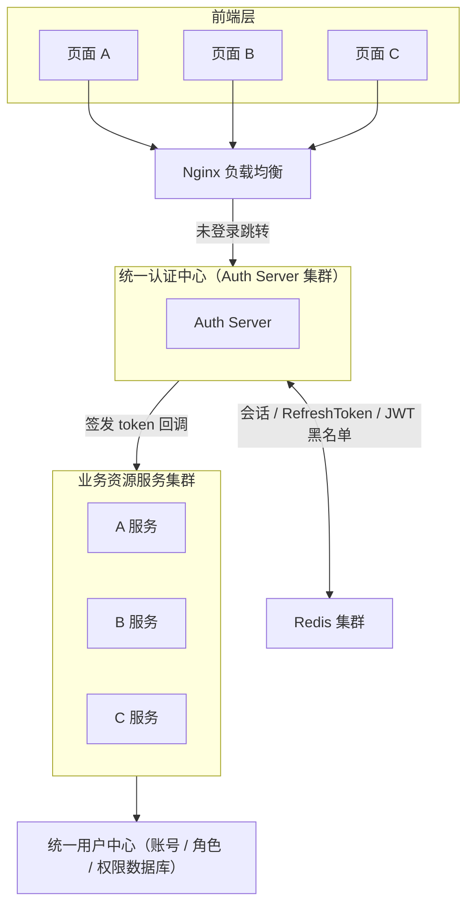

## 核心概念 ##

*单点登录 SSO（Single Sign-On）* ：用户在*一个信任域下任意系统登录一次*，访问域内其他业务系统无需重复输入账号密码。

### 两类场景区分 ###

*同域 SSO*：所有服务共享一级域名（`*.shturl.`），如 `shturl.cc/Xkb`、`shturl.cc/R2`

*跨域 SSO*：多独立域名（`a.com`、`b.com`、`c.com`），需要独立认证中心服务

### 三大主流标准协议 ###

*Session 共享（简易同域）* ：适合小型单体集群，不支持跨域

*OAuth2.0 + JWT（企业内部 / 第三方登录）* ：最通用，前后端分离首选

*SAML2.0（政企、跨组织对接）* ：浏览器重定向 XML 加密，传统政务系统多用

*OIDC（OpenID Connect）* ：基于 OAuth2 封装，标准化身份 SSO（主流云平台）

## 方案 1：同域单点登录 ##

### 适用场景 ###

全部业务子系统共用根域名 `*.company.com`，传统 SpringBoot/PHP 单体项目。

### 实现原理 ###

HTTP Cookie 携带 SessionID，根域共享 Cookie；统一 Redis 存储 Session，所有服务读取同一份会话。

### 流程 ###

1. 用户访问系统 A，未登录跳转统一登录页（登录服务 `auth.company.com`）
2. 输入账号密码校验成功，服务端生成全局 Session 存入 Redis，写入根域 Cookie `company.com`
3. 跳转回系统 A，A 读取根域 Cookie 拿到 SessionID，从 Redis 获取登录态
4. 访问系统 B（`shturl.pany.com`），浏览器自动带上根域 Cookie，B 校验 Redis 会话直接放行

### 优缺点 ###

✅ 实现简单、无额外 token 解析、兼容性好

❌ 仅支持同域名；Redis 压力大；会话集中存储有单点故障风险

### 关键配置示例（Spring Session Redis） ###

```yml
spring:
  session:
    store-type: redis
    cookie:
      domain: .company.com # 根域共享Cookie
      max-age: 86400
```

## 方案 2：JWT + 认证中心（跨域 SSO，最常用） ###

### 架构分层（标准 SSO 三组件） ###

*认证中心 Auth Server*：唯一登录入口，负责账号校验、签发 JWT 令牌

*资源服务 Resource Server*：各业务系统（A、B、C），校验 JWT 鉴权

*客户端 Client*：前端页面、App、小程序

### 两种令牌设计 ###

*Access Token（短期）* ：JWT，有效期短（15~60min），接口鉴权使用

*Refresh Token（长期）* ：存在 Redis / 数据库，用于无感刷新 AccessToken，避免频繁登录

### 完整登录流程（跨域场景，OIDC 简化版） ###

1. 用户访问业务系统 A，检测无登录态，302 重定向至 `auth.com/login?redirect=A系统回调地址`

2. 用户在认证中心输入账号密码，后端校验

3. 校验通过，生成：

   - JWT AccessToken（存储用户身份、权限，无状态）
   - RefreshToken（唯一字符串，绑定用户存入 Redis）

4. 认证中心写*顶级域 Cookie*保存 RefreshToken，同时携带 AccessToken 跳转回 A 系统回调地址

5. A 前端接收 AccessToken，存在 localStorage，后续所有接口请求 Header 携带 `Authorization: Bearer xxx`

6. 访问业务系统 B：直接重定向 auth 中心，浏览器自动携带 RefreshToken Cookie，认证中心自动签发新 AccessToken，免登

### JWT 结构 ###

- Header：加密算法（HS256/RSA256）
- Payload：用户 ID、用户名、过期时间、权限、iss 签发者
- Signature：密钥签名，防止篡改

### 跨域核心解决点 ###

- 不同域名无法共享 Cookie → 依靠认证中心统一跳转传递令牌
- 前端接口跨域 → 服务配置 CORS 放行认证中心域名
- 防止 XSS 窃取 Token：AccessToken 放 localStorage，RefreshToken 设 HttpOnly Cookie

### 优缺点 ###

✅ 支持跨域名、分布式无状态、扩展性强、前后端分离友好

❌ JWT 无法主动失效（需 Redis 黑名单做登出拦截）；token 过大传输成本高

### 登出逻辑 ###

1. 前端清空本地 AccessToken
2. 请求认证中心登出接口
3. 服务端删除 Redis 中该用户 RefreshToken
4. 清除根域 HttpOnly Cookie
5. 维护 JWT 黑名单，短期内拦截未过期旧 AccessToken

## 方案 3：OIDC 标准化 SSO（企业级标准化） ##

基于 OAuth2.0 封装，定义统一身份接口，兼容第三方登录（钉钉、企业微信、Azure AD）

### 核心流程 ###

1. 业务系统发起授权请求到 OIDC 认证服务器
2. 用户登录，服务器返回 ID Token（JWT）+ Access Token
3. 业务系统通过 ID Token 解析用户身份，或调用 /userinfo 接口获取完整用户信息

### 适用场景 ###

企业统一身份平台、第三方应用接入、多租户系统

## 方案 4：SAML2.0（政企、跨组织 SSO） ##

### 架构 ###

- IDP：身份提供商（统一登录服务）
- SP：业务服务系统

### 流程 ###

1. SP 生成认证请求，跳转 IDP
2. IDP 校验用户身份，生成 XML 加密断言（SAML Response）
3. POST 回调至 SP 接口，SP 解析 XML 校验签名完成登录

### 特点 ###

基于 XML、非 REST、安全性高、多用于政府 / 银行，开发复杂度高

## 分布式高可用落地架构（生产标准） ##



### 生产关键优化点 ###

- *认证中心集群*：无状态部署，水平扩容
- *Redis 集群*：持久化会话、RefreshToken、JWT 失效黑名单
- *RSA 非对称加密签发 JWT*：私钥在认证中心，各业务服务仅持有公钥校验，密钥更安全
- *HttpOnly + SameSite Cookie*：防御 CSRF 攻击
- *Token 过期阶梯设计*：AccessToken 短时效降低泄露风险，RefreshToken 延长免登周期
- *统一权限中心*：JWT 仅携带基础 ID，复杂权限实时从权限服务拉取

## 常见安全问题与解决方案 ##

| 风险 | 解决方案 |
| :--- | :--- |
| CSRF 跨站请求伪造 | RefreshToken Cookie 配置 SameSite=Strict、携带 csrf 随机参数 |
| XSS 窃取 Token | AccessToken 存入 localStorage，RefreshToken 开启 HttpOnly 禁止 JS 读取 |
| JWT 篡改 | 使用 RSA 非对称签名，禁止明文密钥 |
| Token 泄露长期可用 | AccessToken 短期失效，登出加入黑名单 |
| 跨域劫持 | CORS 严格限制可信域名，回调地址白名单校验 |
| 会话劫持 | 登录绑定设备指纹（UA+IP），换设备强制重登 |

## 不同场景选型总结 ##

- 小型内部系统、同域名集群 → Session+Redis 共享 Cookie
- 中大型前后端分离、多业务跨域名 → OAuth2+JWT 认证中心 SSO
- 对接第三方企业身份（钉钉 / 飞书）、标准化平台 → OIDC
- 政务、银行、跨机构合作系统 → SAML2.0
